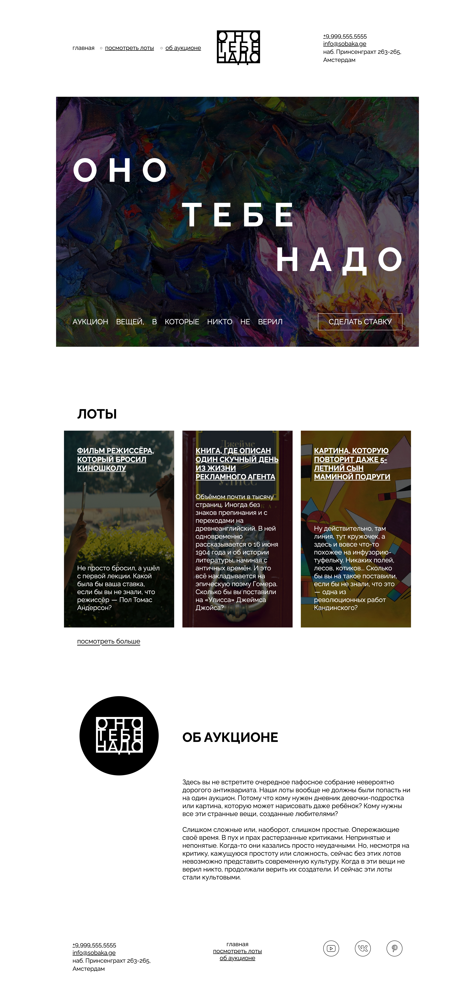

# Яндекс Практикум, 1 спринт — проект «Оно тебе надо»

Учебный проект по вёрстке одностраничного сайта аукциона вещей, в которые никто не верил. Страница создана по макету Figma с использованием HTML и CSS.

**Ссылка на репозиторий:** https://github.com/ElizaaaSh/ono-tebe-nado

## Оглавление

- [Скриншот](#скриншот)
- [Макет](#макет)
- [Запуск](#запуск)
- [Структура](#структура)
- [Ссылки](#ссылки)
- [Автор](#автор)
- [Благодарность](#благодарность)

## Скриншот



## Макет

- [Макет проекта в Figma](https://www.figma.com/design/LMVnt2rLsRjdlEjO3f9ELa/1-%D1%81%D0%BF%D1%80%D0%B8%D0%BD%D1%82.-%D0%9F%D1%80%D0%BE%D0%B5%D0%BA%D1%82%D0%BD%D0%B0%D1%8F-%D1%80%D0%B0%D0%B1%D0%BE%D1%82%D0%B0--Copy-?node-id=0-1&t=8zDqX1AjFkde90eT-1)

## Запуск

Для запуска проекта не требуется установка зависимостей или сборка.

1. Скачайте или клонируйте репозиторий.
2. Откройте папку проекта в Visual Studio Code.
3. Откройте файл `index.html` в браузере.

Сайт также можно запустить через расширение **Live Server** в VS Code.

## Структура

```text
ono-tebe-nado/
├── index.html          # Разметка главной страницы
├── README.md           # Описание проекта
├── webpage_screenshot.png      # Скриншот сайта
├── fonts/
│   └── fonts.css       # Подключение шрифтов
├── images/             # Изображения и SVG-логотипы
└── styles/
    ├── global.css      # Общие стили и сброс браузерных настроек
    └── style.css       # Стили блоков по макету
```

## Ссылки

- Репозиторий проекта: [GitHub](https://github.com/ElizaaaSh/ono-tebe-nado)

## Автор

- GitHub: [ElizaaaSh](https://github.com/ElizaaaSh)

## Благодарность

Благодарю команду Яндекс Практикума за возможность получить практический опыт веб-разработки и применить полученные знания при создании этого проекта.
